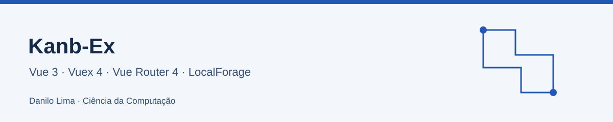
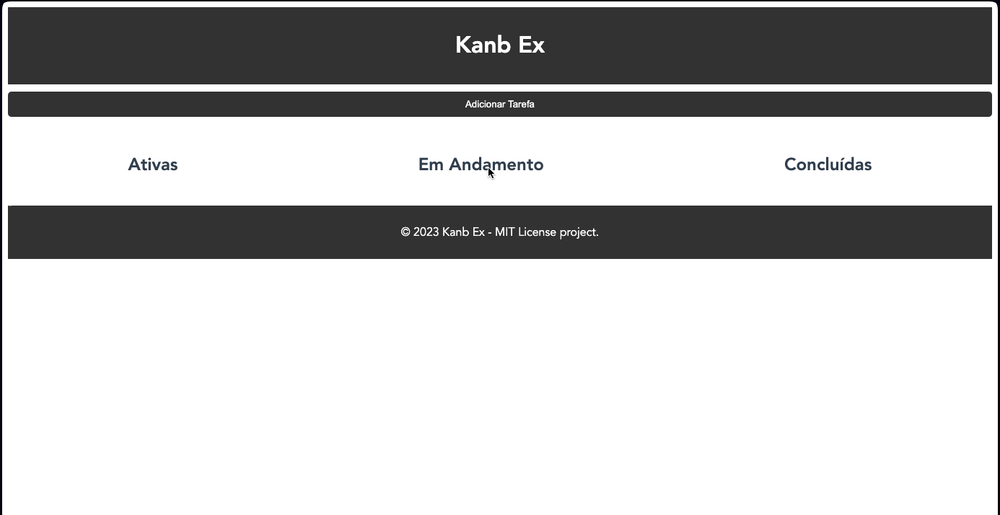

# Kanb-Ex

Quadro Kanban acadêmico para explorar organização visual de tarefas, navegação, estado compartilhado e persistência no navegador. O projeto foi apresentado em Tópicos Especiais em Programação II.

**Tópicos Especiais em Programação II · UFES · 2023/2**

Vue 3 · Vuex 4 · Vue Router 4 · LocalForage

[English](README.en.md) · [Meu percurso em Ciência da Computação](https://github.com/Danilo-Js/My-Computer-Science-Course)

<p align="center"></p>

## O que este projeto explora

- Decomposição da interface em componentes Vue.
- Organização de estado e navegação entre visões.
- Persistência local para explorar o comportamento de um aplicativo no navegador.

## Como explorar

| Caminho | Conteúdo |
|---|---|
| [Componentes, estado e rotas](src) | `src` |
| [Demonstração original](ReadmeAssets/Presentation.gif) | `ReadmeAssets/Presentation.gif` |
| [Dependências e comandos](package.json) | `package.json` |

## Executar ou consultar

```bash
npm ci
npm run serve
```

Os comandos disponíveis são `serve`, `build` e `lint`, definidos em [package.json](package.json). O projeto utiliza Vue CLI 5 e dependências históricas; confira compatibilidade do ambiente antes de atualizar versões.

## Conceitos e contexto

Projeto acadêmico com armazenamento local. Não é apresentado como plataforma SaaS multiusuário ou serviço comercial implantado.

## Autoria e procedência

Danilo José Lima de Oliveira e Bernardo Mangaraviti Carrerette. Trabalho da disciplina ministrada por Giuliano Prado, segundo semestre de 2023.

## Licença

Os termos deste acervo estão em [LICENSE](LICENSE). Os projetos e materiais vinculados conservam suas próprias condições e atribuições.
